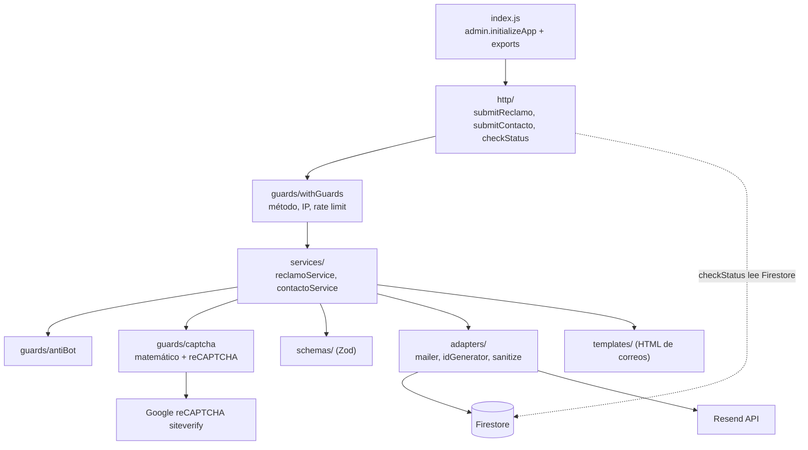

# Backend `functions/` - Arquitectura y operación

> Documento verificado contra el código de la rama `chore/verificar-functions-backend` el 2026-10-29.
> Las tres funciones fueron **desplegadas en producción el 2026-10-29** con el código de esta arquitectura (runtime `nodejs22`). Las verificaciones posteriores al despliegue están en la sección 9.

## 1. Propósito

Backend serverless de GLASS & ALUMINUM COMPANY S.A.C. sobre Firebase Functions v2 (Node.js 22, CommonJS). Atiende tres funciones HTTP del sitio público:

- **`submitReclamo`**: Libro de Reclamaciones (Indecopi, D.S. N° 011-2011-PCM, Ley N° 29571 y Ley N° 31435).
- **`submitContacto`**: formulario de contacto y cotizaciones.
- **`checkStatus`**: consulta pública del estado de una solicitud por su código de seguimiento.

Cada envío válido se guarda en Firestore, se notifica por correo con Resend (a la empresa y al cliente) y pasa por varias capas de protección: CORS por entorno, rate limit, anti-bot, captcha matemático firmado y reCAPTCHA v3.

## 2. Arquitectura por capas



| Ruta | Responsabilidad |
|---|---|
| `index.js` | Inicializa `firebase-admin` y exporta las tres funciones. |
| `src/http/` | Un archivo por función HTTP. Define `onRequest` (timeout, memoria, `maxInstances`, secretos, CORS) y envuelve el handler con `withGuards`. |
| `src/guards/withGuards.js` | Envoltorio común: responde 405 si el método no está permitido, obtiene la IP, aplica el rate limit y decide la política ante fallo de Firestore (`failOpen`). |
| `src/guards/clientIp.js` | Obtiene la IP del cliente desde `X-Forwarded-For` (ver sección 4). |
| `src/guards/rateLimit.js` | Rate limit atómico en Firestore (transacción), por función e IP. |
| `src/guards/antiBot.js` | Predicados anti-bot: honeypot, envío demasiado rápido (`_ts`) y texto basura. |
| `src/guards/captcha.js` | Reto matemático firmado (`validateMathCaptcha`) y verificación de reCAPTCHA v3 (`verifyRecaptcha`). |
| `src/schemas/` | Esquemas Zod `reclamo.js` y `contacto.js`: validación del lado del servidor. |
| `src/services/` | Lógica de negocio: `reclamoService.js` (`sendEmailLogic`) y `contactoService.js` (`sendContactEmailLogic`). |
| `src/adapters/mailer.js` | Cliente de Resend y `sendNotifications` (envío en paralelo con `Promise.allSettled`). |
| `src/adapters/idGenerator.js` | Códigos de seguimiento `GYA-REC-...` / `GYA-CON-...` con `createWithUniqueCode`. |
| `src/adapters/sanitize.js` | `stripHtml`, listas blancas de campos (`buildSafeReclamoPayload`, `buildSafeContactPayload`) y `sanitizeHtml`. |
| `src/templates/` | HTML de los correos (administrador y cliente) para cada flujo. |
| `src/config/cors.js` | Orígenes permitidos: en producción solo dominios de la empresa y Firebase Hosting; `localhost` y `127.0.0.1` fuera de producción. |
| `src/config/limits.js` | Ventana del rate limit, máximos por función, `TRUSTED_PROXY_HOPS` y horas de TTL. |
| `emailSender.js`, `mathCaptchaValidator.js` | Shims de compatibilidad: solo re-exportan código de `src/`. |
| `test/` | Pruebas con `node:test`. `helpers.js` inyecta dobles de Resend y de `fetch` (reCAPTCHA) y `fakeDb.js` simula Firestore. |
| `.eslintrc.js` | Configuración de ESLint 8 (`eslint:recommended` y `google`). |

Notas de organización:

- `functions/` usa **npm** (tiene `package-lock.json`), no pnpm.
- `functions/.gitignore` ignora `node_modules/` y `*.local`; el `.env` local queda ignorado por la regla `.env` del `.gitignore` raíz.

## 3. Funciones expuestas

| Función | Método | Límite por IP (15 min) | Secretos declarados | Colección Firestore | Timeout | Si falla Firestore en el rate limit |
|---|---|---|---|---|---|---|
| `submitReclamo` | POST | 8 | `RESEND_API_KEY`, `ADMIN_EMAIL`, `RECAPTCHA_SECRET_KEY` | `libro_de_reclamaciones` | 60 s | **503** (cerrado) |
| `submitContacto` | POST | 8 | `RESEND_API_KEY`, `ADMIN_EMAIL`, `RECAPTCHA_SECRET_KEY` | `contact_submissions` | 60 s | **503** (cerrado) |
| `checkStatus` | GET, POST | 30 | ninguno | lectura de `contact_submissions` y `libro_de_reclamaciones` | 30 s | se permite (abierto) |

Común a las tres: `memory: 256MiB`, `maxInstances: 10`, CORS con `ALLOWED_ORIGINS`. El rate limit es por función: cada una tiene su propio bucket.

## 4. Flujo paso a paso de un reclamo (`submitReclamo`)

Orden real del código (`src/http/submitReclamo.js` → `src/services/reclamoService.js`):

1. **Método** (`withGuards`): si no es POST, responde **405**.
2. **IP del cliente** (`clientIp.js`): se toma la entrada de `X-Forwarded-For` que añade la infraestructura (Cloud Run / Google Front End), es decir la entrada en la posición `length - TRUSTED_PROXY_HOPS` con `TRUSTED_PROXY_HOPS = 1`. Si no hay cabecera válida se usa la IP del socket; si tampoco, `"unknown"`. **DESPLEGADO el 2026-10-29** y de confirmación empírica (sección 11).
3. **Rate limit** (`rateLimit.js`): documento `rate_limits/{funcion}_{ip}` (los `:` y `.` de la IP se reemplazan por `_`), lectura y escritura en una **transacción**. Máximo 8 marcas de tiempo por ventana de 15 minutos; al excederlo responde **429**. Si Firestore falla responde **503**. Con IP `"unknown"` no se aplica límite. **DESPLEGADO el 2026-10-29**.
4. **Configuración**: si falta `ADMIN_EMAIL` responde **500** (`failed-precondition`).
5. **Anti-bot silencioso**: honeypot (`middleName` o `website_hp` rellenados), envío en menos de 1,8 s (`_ts`) o texto basura (`isGibberishOrSpamText`). En estos casos **no se guarda ni se envía nada** y la respuesta es de éxito con `id: "GHOST_BLOCKED"`.
6. **Zod** (`reclamoSchema`): longitudes, caracteres prohibidos `<>{}` en los campos de texto, enums de tipo de documento, tipo de solicitud y tipo de bien, y monto. Error: **400**.
7. **Captcha matemático** (`validateMathCaptcha`): firma, expiración de 15 minutos y resultado. Error: **400**.
8. **reCAPTCHA v3** (`verifyRecaptcha`, acción `reclamation_submit`, puntuación mínima 0,5). Token ausente, puntuación baja, acción distinta o verificación caída: **403**. Secreto ausente: **500**.
9. **Documento de identidad y campos obligatorios**: DNI de 8 dígitos; carné de extranjería 8 a 12 alfanuméricos; pasaporte 6 a 12; RUC que empiece por 10, 15, 17 o 20 con 11 dígitos. Error: **400**.
10. **Persistir primero** (`createWithUniqueCode`): `buildSafeReclamoPayload` (lista blanca de campos) y `create()` del documento `libro_de_reclamaciones/{código}`, con estado `RECIBIDO` y notificaciones en `PENDING`. Si `create()` falla por algo distinto a colisión de código, responde **500** con un mensaje genérico y el detalle queda en el log. **DESPLEGADO el 2026-10-29**.
11. **Notificar en paralelo** (`sendNotifications`, `Promise.allSettled`): correo al administrador (`ADMIN_EMAIL`) con el código real y correo de constancia al cliente.
12. **Registrar el resultado**: `update` de `notifications.admin` y `notifications.client` con `SENT` (y `resendId`) o `FAILED` (y `error`, sin direcciones de correo). Si este `update` falla, solo se registra en el log y el documento queda en `PENDING`.
13. **Respuesta**: `{ success: true, data: { id, createdAt } }`. Un fallo de correo **no** invalida el registro: la respuesta sigue siendo de éxito.

`submitContacto` sigue el mismo patrón, con estas diferencias:

- El orden de validación es: anti-bot (paso 5), **captcha matemático**, **reCAPTCHA** (acción `contact_submit`) y **después** Zod con `contactSchema`.
- No valida documento de identidad ni campos obligatorios de reclamo.
- Persiste en `contact_submissions` con código `GYA-CON-...`. El correo al administrador lleva `reply_to` con el correo del cliente.
- La respuesta incluye un mensaje: `{ success: true, message: "Consulta enviada exitosamente.", data: { id, createdAt } }`.

Errores de los handlers: el código `invalid-argument` responde 400, `permission-denied` responde 403 y cualquier otro error responde 500. Ver el punto abierto sobre `error.message` en la sección 11.

## 5. Códigos de seguimiento

- Formato: `GYA-REC-AAAA-XXXXXX` (reclamos) y `GYA-CON-AAAA-XXXXXX` (contacto).
- `AAAA` es el año en la zona `America/Lima`. `XXXXXX` son 6 caracteres aleatorios (`crypto.randomInt`) del alfabeto `ABCDEFGHJKLMNPQRSTUVWXYZ23456789`, sin `0`, `O`, `1` ni `I`.
- El código es también el ID del documento. Se crea con `create()`, que falla si ya existe; ante colisión se regenera, hasta 5 intentos.
- **No es correlativo**: no existe hoy numeración secuencial (ver sección 10).
- **DESPLEGADO el 2026-10-29**: antes el código era el ID devuelto por Resend. Los documentos antiguos conservan ese ID; `checkStatus` acepta ambos formatos.

## 6. Modelo de datos guardado

### Reclamo (`libro_de_reclamaciones/{GYA-REC-...}`)

| Campo | Origen / valor |
|---|---|
| `nombreCompleto`, `email`, `tipoDocumento`, `numeroDocumento`, `domicilio`, `telefono`, `tipoSolicitud`, `tipoBien`, `descripcionBien`, `detalle`, `pedido` | `buildSafeReclamoPayload` (texto sin etiquetas HTML; `email` en minúsculas) |
| `montoReclamado` | Número (`Number(...)`, 0 por defecto) |
| `id` | Código de seguimiento |
| `status` | `"RECIBIDO"` |
| `createdAt` | `serverTimestamp()` de Firestore |
| `createdAtIso` | Fecha ISO de creación |
| `source` | `"PROD_WEB"` |
| `clientIp` | IP del cliente (dato personal, ver sección 11) |
| `legalRetentionUntil` | Fecha ISO de creación + 2 años (plazo de conservación) |
| `notifications.admin` / `notifications.client` | `{ status: "PENDING" }` al crear; luego `{ status: "SENT", resendId }` o `{ status: "FAILED", error }` |

### Consulta de contacto (`contact_submissions/{GYA-CON-...}`)

Mismos campos de control (`id`, `status`, `createdAt`, `createdAtIso`, `source`, `clientIp`, `notifications`), más `name`, `email`, `phone` y `message` (`buildSafeContactPayload`). **No tiene `legalRetentionUntil`.**

### Respuesta de `checkStatus`

`{ success: true, data: { id, type, status, createdAt, name, maskedName } }`, donde `type` es `"Libro de Reclamaciones"` o `"Consulta de Contacto"`. El nombre se ofusca (p. ej. `Lu*** Pe***`) y, si no existe, aparece como `"Usuario Registrado"`. Si el ID tiene más de 200 caracteres o contiene `/`, responde 404. Si el código empieza por `gya-` en minúsculas, también prueba la versión en mayúsculas.

## 7. Colecciones y reglas de seguridad

| Colección | Quién escribe | Acceso desde el cliente (`firestore.rules`) |
|---|---|---|
| `libro_de_reclamaciones` | Backend (Admin SDK) | `read, write: if false` |
| `contact_submissions` | Backend (Admin SDK) | `read, write: if false` |
| `rate_limits` | Backend (Admin SDK) | `read, write: if false`; campo `expireAt` para TTL (activación pendiente) |

Las reglas incluyen un cierre por defecto que deniega todo lo no listado. Las reglas de Firestore y Storage están en [`firestore.rules`](../firestore.rules) y [`storage.rules`](../storage.rules). **Son código congelado**: solo se modifican si se pide explícitamente.

## 8. Calidad: pruebas, lint y auditoría

Ejecutar desde `functions/`:

```bash
cd functions
npm test          # node --test test/*.test.js
npm run lint      # ESLint 8 con .eslintrc.js
npm audit --omit=dev
```

- **Pruebas**: 120 pruebas en 21 suites, todas en verde el 2026-10-29. Usan `node:test` con dobles de Resend, Firestore y reCAPTCHA (`fetch`); no necesitan emulador.
- **Lint**: 0 errores y 1 advertencia de `max-len` en `src/services/reclamoService.js` (línea 70).
- **Auditoría de producción**: 11 vulnerabilidades (1 alta, 10 moderadas). La alta es `body-parser`, transitiva vía `@google-cloud/functions-framework`, que es dependencia directa. Según el análisis previo del equipo, corregirlas exige subir `@google-cloud/functions-framework` a 4.0.1 (Express 5) o `firebase-admin` a 14, cambios que rompen compatibilidad y no se han aplicado.
- **Emulador local**: `npm run serve` (requiere Java JDK). Las URL del frontend se apuntan al emulador según [06_DOCS_DEVELOPMENT.md](../docs/06_DOCS_DEVELOPMENT.md).
- **Postman**: las colecciones de `tests/postman/` están alineadas con el contrato actual (commit `61af7db`). Ver [tests/postman/README.md](../tests/postman/README.md).

## 9. Despliegue

### Estado actual

- Producción corre `nodejs22` con el código actual de la rama: capas, persistir primero con código propio y rate limit endurecido (desplegado el 2026-10-29).
- Verificado en producción tras el despliegue: las tres funciones listan `nodejs22`; `GET` a `submitReclamo` responde 405; con 9 peticiones seguidas y un `X-Forwarded-For` distinto y forjado en cada una, la 9.ª recibe 429 (el límite no usa el valor forjado); un honeypot responde 200 con `GHOST_BLOCKED` sin enviar ni guardar nada; CORS rechaza `http://localhost:3000` y acepta `https://www.gyacompany.com`.
- Sin confirmar todavía: que la IP resuelta sea la IP pública real del cliente y no una IP compartida de Google (no se pudo leer el log desde esta máquina). Ver la sección 11, punto 3.

### Procedimiento

Desde la raíz del repositorio, con validación previa en `functions/`:

```bash
cd functions && npm test && npm run lint && cd ..
firebase deploy --only functions:submitReclamo,functions:submitContacto,functions:checkStatus --non-interactive
```

Tras el despliegue:

1. Confirmar que `TRUSTED_PROXY_HOPS = 1` toma la IP real: enviar una petición con un `X-Forwarded-For` forjado y revisar en los logs qué entrada coincide con la IP real.
2. Activar la política TTL de `rate_limits` sobre el campo `expireAt` (consola de Firebase / Firestore).
3. Actualizar el estado de despliegue de este README, de [07_BACKEND_IMPLEMENTATION.md](../docs/07_BACKEND_IMPLEMENTATION.md) y de [08_DOCS_SECURITY_BACKEND.md](../docs/08_DOCS_SECURITY_BACKEND.md).

### Advertencias

- **Nunca usar `--force`**: `firebase deploy --only functions --force` borra las funciones desplegadas que no estén en el código. `testFunction` existe en producción y no está en el repositorio.
- **Conflicto con `RECAPTCHA_SECRET_KEY`**: el `.env` local de `functions/` (ignorado por git) define `RECAPTCHA_SECRET_KEY` y el código la declara también como secreto. Cloud Run rechaza el despliegue. Hasta que se elimine esa línea del `.env`, el archivo debe apartarse de `functions/` durante el comando y restaurarse después. Detalle en [08_DOCS_SECURITY_BACKEND.md](../docs/08_DOCS_SECURITY_BACKEND.md).

## 10. Cómo agregar una función nueva (p. ej. `submitPresupuesto`)

Reutilizar los bloques existentes en lugar de copiar lógica:

- `withGuards` (método, IP y rate limit por función).
- `antiBot` (`isHoneypotFilled`, `isSubmissionTooFast`, `isGibberishOrSpamText`).
- `captcha` (`validateMathCaptcha` y `verifyRecaptcha(token, "accion")`; la acción debe coincidir con la del frontend).
- `mailer` (`createMailer`, `sendNotifications`, `cleanSubject`).
- `sanitize` (`stripHtml` y una lista blanca nueva en `buildSafe...Payload`; nunca persistir `request.body` crudo).
- `idGenerator` (`createWithUniqueCode`).

Pasos:

1. **Límite**: añadir la entrada en `RATE_LIMITS` de `src/config/limits.js`.
2. **Esquema**: `src/schemas/presupuesto.js` con Zod.
3. **Servicio**: `src/services/presupuestoService.js` con el orden de los flujos existentes: anti-bot, captcha matemático, reCAPTCHA, Zod, persistir y después notificar, registrando el resultado en `notifications`.
4. **Persistencia**: `createWithUniqueCode` con la colección elegida. El prefijo nuevo (por ejemplo `PRE`) debe añadirse también al JSDoc de `generateCode` en `src/adapters/idGenerator.js`. El nombre de la colección y del prefijo son decisiones pendientes.
5. **Handler**: `src/http/submitPresupuesto.js` con `onRequest` y `withGuards`, igual que `submitContacto.js`. Declarar solo los secretos que use.

   ```js
   exports.submitPresupuesto = onRequest(
     { timeoutSeconds: 60, memory: "256MiB", maxInstances: 10,
       secrets: ["RESEND_API_KEY", "ADMIN_EMAIL", "RECAPTCHA_SECRET_KEY"], cors: ALLOWED_ORIGINS },
     withGuards({ name: "submitPresupuesto", methods: ["POST"], limit: RATE_LIMITS.submitPresupuesto, failOpen: false },
       async (request, response, { clientIp }) => {
         // igual que submitContacto: llamar al servicio y responder 200 / 400 / 403 / 500
       })
   );
   ```

6. **Exportar** en `index.js`.
7. **Consulta de estado**: si el usuario debe poder consultar sus presupuestos, añadir la colección a los candidatos de `src/http/checkStatus.js` (hoy solo busca en dos colecciones).
8. **Reglas**: la colección nueva queda denegada por el cierre por defecto. Cualquier cambio en `firestore.rules` requiere solicitud explícita.
9. **Pruebas**: `test/presupuesto.test.js` con `helpers.js` y `fakeDb.js`, siguiendo `contacto.test.js`.
10. **Postman**: actualizar `tests/postman/` con la nueva ruta.

**Numeración correlativa**: no existe hoy. Los códigos son aleatorios y se garantiza unicidad con `create()`. Si se quiere numeración correlativa por transacción (un contador por año y tipo), habría que diseñarla: no está implementada.

## 11. Pendientes y decisiones abiertas

| # | Tema | Estado | Detalle |
|---|---|---|---|
| 1 | Desplegar los cambios de la rama | **Hecho el 2026-10-29** | Capas, persistir primero, código propio y rate limit por función. |
| 2 | Política TTL de `rate_limits` sobre `expireAt` | Pendiente (consola) | Sin la política, los documentos de rate limit no caducan solos. |
| 3 | `TRUSTED_PROXY_HOPS = 1` | Parcialmente confirmado | Confirmado: un `X-Forwarded-For` forjado no evade el límite (la 9.ª petición da 429). Falta confirmar en el log que la IP registrada es la IP pública real y no una IP compartida de Google. Riesgo si fuera compartida: todos los usuarios comparten un cupo de 8 envíos cada 15 minutos. |
| 4 | Captcha matemático: sal pública y firma de 32 bits | Fuera de alcance, documentado | La sal `GYA_MATH_SECURE_SALT_2026` está en `src/shared/utils/mathCaptcha.ts` y como valor por defecto en `src/guards/captcha.js`. El token es reutilizable durante 15 minutos. |
| 5 | Secreto de reCAPTCHA en la URL de `siteverify` | Fuera de alcance, documentado | Google también admite enviarlo en el cuerpo del POST. |
| 6 | Conflicto de `RECAPTCHA_SECRET_KEY` en `functions/.env` | Pendiente del responsable | Eliminar la línea; el valor ya está en Secret Manager. |
| 7 | Fallo al actualizar `notifications` | Abierto | El documento queda en `PENDING` sin reintento; solo se registra en el log. |
| 8 | Sin reintento automático de correos | Abierto (idea) | Posible trigger `onDocumentCreated` sobre las colecciones de solicitudes. |
| 9 | Mensajes de error no controlados | Abierto | Los handlers responden `error.message` para cualquier excepción que no sea `HttpsError`. |
| 10 | `_ts` lo envía el cliente | Abierto | Un bot puede falsificarlo; el filtro solo detiene bots simples. |
| 11 | PII en logs y `clientIp` persistido | Abierto | Correos y nombres aparecen en logs; la IP se guarda en cada registro (Ley N° 29733). |
| 12 | IP desconocida sin límite | Abierto (decisión a revisar) | Con IP `"unknown"` el rate limit deja pasar la petición. |
| 13 | Silent drop responde éxito | Decisión deliberada | `GHOST_BLOCKED` no guarda ni envía nada y no revela la detección. |
| 14 | Rate limit antes del anti-bot | Decisión deliberada | Los bots consumen cuota del rate limit. |
| 15 | Auditoría de dependencias | Abierto | 11 vulnerabilidades; requiere actualizar `@google-cloud/functions-framework` o `firebase-admin` con cambios mayores. |
| 16 | Advertencia `max-len` en `reclamoService.js` | Menor | Línea 70; no afecta al funcionamiento. |
| 17 | Numeración correlativa | No existe | Decisión de diseño pendiente. |
| 18 | `submitPresupuesto` | Futuro | Seguir la sección 10. |

---
*Documento técnico de `functions/`. Fuentes: `functions/src/`, `functions/index.js` y `functions/test/`.*
