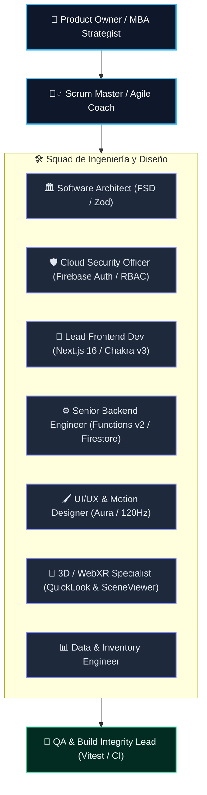

# ROADMAP | Plan de Trabajo Ágil (Scrum) por Sprints y Fases

**Portal Corporativo y Transaccional GYA — Glass & Aluminum Company S.A.C.**
Documento de gestión ágil · Scrum Framework · 2026 · Estado sincronizado con el código el 2026-10-29

---

> **Resumen Ejecutivo (Executive Summary):**  
> Este documento establece el marco de trabajo ágil (**Scrum Framework**) para la construcción de la plataforma transaccional de **Glass & Aluminum Company S.A.C.** El plan se estructura en **5 Sprints / Fases Incrementales** con Definition of Done (DoD), ceremonias ágiles simuladas (Sprint Planning, Daily Standup, Sprint Review, Retrospective) y asignación estricta de tareas por cada uno de los roles especialistas senior del equipo técnico y de negocio.

---

## § 1. Estructura del Equipo Scrum y Roles Seniors Asignados



---

## § 2. Roadmap General de Sprints (Fases de Ejecución)

Estado verificado contra el código el 2026-10-29 (HEAD `d4e6685`).

| Sprint | Objetivo del incremento | Enfoque principal | Estado real |
|:-:|---|---|---|
| **Sprint 1** | Autenticación RBAC y perfil de cliente | Auth, roles (admin/cliente), DNI/RUC | ✅ Implementado, salvo `useUserProfile` como hook (lo expone `useAuth`) y el guard `/mi-cuenta` (no existe) |
| **Sprint 2** | Gestión de inventario y panel admin CRUD | Stock, alertas, medidas, fotos en Storage | ✅ Implementado (la subida de imágenes a Storage no está implementada: el producto guarda `imageUrl`) |
| **Sprint 3** | Catálogo e-commerce y carrito de compras | Filtros, checkout, WhatsApp/transferencia | 🟡 Parcial: hay pedidos de admin (`/admin/ventas`), pero no hay tienda pública, carrito ni checkout |
| **Sprint 4** | Cotizador inteligente y presupuesto en PDF | Motor paramétrico m², hoja A4 con QR | 🟢 Casi completo: `/presupuesto` con calculadora y hoja imprimible; faltan QR, correlativo real y persistencia en `presupuestos_solicitados` |
| **Sprint 5** | Visor de Realidad Aumentada (AR Web) | Apple QuickLook `.usdz`, SceneViewer `.glb` | ⏳ Pendiente (no existe código ni assets `.glb/.usdz`) |

## 🏃‍♂️ SPRINT 1: Autenticación RBAC, Sesiones y Perfiles de Cliente

> **Meta del Sprint (Sprint Goal):** Proveer un sistema seguro de inicio de sesión y registro para clientes (con DNI/RUC, teléfono, dirección y distrito) y administradores, con control de acceso basado en roles (RBAC) y contexto global de sesión.

### 📋 Checklist de Actividades por Rol Senior:

#### 1. 🛡️ Cloud & Security Officer
- [x] **1.1** Configurar métodos de inicio de sesión en Firebase Auth (Email & Password).
- [x] **1.2** Implementar reglas de validación en `firestore.rules` para la colección `/users` y `/clientes`.
  > Nota (2026-10-29): las reglas existen, pero `clientes` permite escritura a cualquier usuario autenticado y `users` a su propio dueño; conviene endurecerlas (ver `firestore.rules`, congelado salvo petición).
- [ ] **1.3** Garantizar que un usuario no pueda auto-asignarse el rol `admin` desde el frontend.
  > Pendiente: la regla de `users/{userId}` permite escribir el propio documento (incluido `role`), y `isAdmin()` y `AuthContext` también conceden admin por email (contiene `admin` o termina en `@gyacompany.com`). Revisar con el responsable del proyecto.

#### 2. 🏛️ Enterprise Software Architect
- [x] **1.4** Crear contexto global de autenticación `AuthContext` en `src/features/auth/context/AuthContext.tsx`.
- [ ] **1.5** Diseñar los hooks de negocio `useAuth` y `useUserProfile` con sincronización de Firestore.
  > Parcial: `useAuth` existe y expone `profile` y `role`; no hay un hook `useUserProfile` separado.
- [ ] **1.6** Implementar guardias de rutas protegidas para la sección administrativa (`/admin/**`) y de cliente (`/mi-cuenta/**`).
  > Parcial: `/admin/**` está protegido con `src/shared/components/guards/AdminRouteGuard.tsx` (guard en cliente; las rutas se prerenderizan estáticas). La ruta `/mi-cuenta` no existe.

#### 3. 🎨 Lead Frontend & UI/UX Designer
- [x] **1.7** Diseñar la pantalla de Login con estética Aura Glass en `src/screens/Auth/LoginScreen.tsx`.
- [ ] **1.8** Diseñar el formulario de Registro de Clientes con validación en vivo de DNI (8 dígitos) y RUC (11 dígitos).
  > Parcial: el registro existe en `/auth` (`LoginScreen.tsx`) y el esquema `dniRuc` exige entre 8 y 11 caracteres; no se verificó validación estricta de 8 u 11 dígitos.
- [x] **1.9** Añadir microinteracciones de carga con spinner y toasts de notificación accesibles.

#### 4. 🧪 QA & Build Integrity Lead
- [ ] **1.10** Crear suite de pruebas unitarias `tests/unit/auth-service.test.ts`.
  > Pendiente: el archivo no existe.
- [ ] **1.11** Validar que `pnpm run test:run` y `pnpm run typecheck` pasen al 100%.
  > Se valida en la CI (`.github/workflows/ci.yml`); no se ejecutó en esta sincronización documental.

---

## 🏃‍♂️ SPRINT 2: Gestión de Inventario & Panel de Administración (CRUD)

> **Meta del Sprint (Sprint Goal):** Permitir al administrador gestionar el inventario en tiempo real: crear, listar, editar y deshabilitar productos (vidrios, perfiles de aluminio y accesorios), controlar existencias (stock) y recibir alertas de stock mínimo.

### 📋 Checklist de Actividades por Rol Senior:

#### 1. 📊 Data & Inventory Engineer
- [x] **2.1** Crear servicio de base de datos `src/features/products/services/productService.ts` con consultas indexadas y soporte para paginación/filtrado.
- [ ] **2.2** Configurar subida de imágenes de producto a Firebase Storage en la ruta `products/{productId}/thumbnail.webp`.
  > Pendiente: `storage` se inicializa en `src/shared/lib/firebase.ts` y `storage.rules` permite `products/`, pero ningún código de `src/` sube archivos; el producto guarda `imageUrl`.

#### 2. 🎨 Lead Frontend Dev & UI/UX Designer
- [x] **2.3** Construir el Dashboard de Inventario en `src/screens/Admin/InventoryDashboardScreen.tsx` con tabla responsiva Aura.
- [x] **2.4** Diseñar modal interactivo de creación/edición de productos con selector de unidad (m², barras, unidades, kg) y dimensiones.
- [x] **2.5** Implementar badge visual de advertencia de stock bajo (`stock <= minStockAlert`, en `inventory/ProductTable.tsx`).

#### 3. 💼 MBA & Product Strategist
- [x] **2.6** Validar cálculo de margen bruto (`margen = (unitPrice - costPrice) / unitPrice`) en el formulario de edición de precios.

#### 4. 🧪 QA & Build Integrity Lead
- [ ] **2.7** Pruebas unitarias de mutación de stock y validación Zod en `tests/unit/inventory-crud.test.ts`.
  > Pendiente: el archivo no existe. Hay cobertura parcial en `tests/unit/ecommerce-schemas.test.ts` e `initial-products.test.ts`.

---

## 🏃‍♂️ SPRINT 3: Catálogo E-Commerce & Carrito de Compras

> **Meta del Sprint (Sprint Goal):** Ofrecer una experiencia de compra fluida al cliente para adquirir vidrios, perfiles y accesorios, con carrito de compras reactivo, cálculo de subtotales y opciones de checkout formal (transferencia bancaria / WhatsApp corporativo).

> **Estado real (2026-10-29):** parcial. Existe el módulo de pedidos de administración (`/admin/ventas` → `SalesOrderScreen.tsx`, `orderService.ts`, `useRealtimeOrders.ts`), además de `ReportsScreen.tsx` y `ClientManagementScreen.tsx`. No hay tienda pública, carrito ni checkout.

### 📋 Checklist de Actividades por Rol Senior:

#### 1. 🏛️ Enterprise Software Architect
- [ ] **3.1** Crear store reactivo de carrito de compras `useCartStore` con persistencia en `localStorage`.
  > Pendiente: no existe `useCartStore` ni estado global de carrito (solo `OrderDraftContext` para el borrador de pedidos de admin).
- [ ] **3.2** Validar que la cantidad en carrito no exceda el stock disponible en Firestore.
  > Pendiente (no hay carrito). `orderService.ts` descuenta stock de forma atómica en los pedidos de admin.

#### 2. 🎨 Lead Frontend & UI/UX Designer
- [ ] **3.3** Construir la vista de Catálogo Comercial en `src/screens/Tienda/ShopScreen.tsx` con filtros por categoría.
  > Pendiente: `src/screens/Tienda/` no existe.
- [ ] **3.4** Diseñar Drawer lateral de Carrito de Compras con micro-animaciones Framer Motion a 120Hz.
- [ ] **3.5** Crear pantalla de Checkout (`/tienda/checkout`) con resumen de compra y datos de envío/visita técnica.

#### 3. 💼 MBA & Product Strategist
- [ ] **3.6** Implementar sugerencias de productos complementarios (Cross-selling: ej. si compras perfil Serie 25, sugerir rodajes y cerradura pico de loro).

#### 4. 🧪 QA & Build Integrity Lead
- [ ] **3.7** Tests unitarios del flujo de carrito y cálculos de totales en `tests/unit/cart-engine.test.ts`.
  > Pendiente: el archivo no existe. Existe `tests/unit/order-transactions.test.ts` para contratos de pedidos de admin.

---

## 🏃‍♂️ SPRINT 4: Cotizador Inteligente & Generador de Presupuesto en PDF

> **Meta del Sprint (Sprint Goal):** Automatizar el cálculo de presupuestos de obras e instalaciones a medida (ventanas, mamparas, duchas, techos) con desglose exacto de materiales, mano de obra, IGV y generación de documento membretado en PDF con código QR legal.

### 📋 Checklist de Actividades por Rol Senior:

#### 1. 💼 MBA & Software Architect
- [x] **4.1** Implementar motor matemático de presupuestación en `src/features/presupuesto/utils/quoteCalculator.ts`:
  ```text
  Total = [ (Vidrio m² × Pv) + (Aluminio metros × Pa) + Accesorios + Mano de Obra ] × 1.18
  ```
- [ ] **4.2** Permitir la carga y parametrización de la tabla de precios oficial de GYA.

#### 2. 🎨 Lead Frontend & Web Designer
- [x] **4.3** Construir el Cotizador Interactivo Paso a Paso (Wizard) en `src/screens/Presupuesto/PresupuestoWizardScreen.tsx` (ruta `/presupuesto`).
- [ ] **4.4** Diseñar la plantilla de Hoja de Presupuesto Membretada A4 (`@media print`) con logo oficial de GYA, RUC, tabla de partidas y código QR de verificación.
  > Parcial: la hoja membretada e impresión (`window.print()`) existen en `PresupuestoWizardScreen.tsx`; no se encontró código QR.
- [ ] **4.5** Implementar botón de confirmación de solicitud (*"Aceptar Presupuesto y Agendar Visita Técnica"*), persistiendo el registro en la colección Firestore `/presupuestos_solicitados`.
  > Pendiente: la colección `presupuestos_solicitados` existe en `firestore.rules`, pero ningún código de `src/` la usa.

#### 3. 🧪 QA & Build Integrity Lead
- [ ] **4.6** Tests unitarios con casos extremos de metraje y verificación del correlativo `GYA-2026-XXXX`.
  > Parcial: `tests/unit/quote-calculator.test.ts` cubre el cálculo (2 casos). El correlativo del wizard está fijo (`0842`) y el esquema `ecommerce-schemas.ts` genera uno aleatorio; sin pruebas del correlativo.

---

## 🏃‍♂️ SPRINT 5: Visor de Realidad Aumentada (AR Web Nativa)

> **Estado real (2026-10-29):** pendiente; no existe `AuraModelViewer.tsx`, `src/shared/components/3d/` ni archivos `.glb/.usdz` en `public/`.

> **Meta del Sprint (Sprint Goal):** Permitir a los clientes proyectar en escala 1:1 ventanas, mamparas y puertas de ducha en sus espacios reales usando la cámara de su celular sin instalar apps externas.

### 📋 Checklist de Actividades por Rol Senior:

#### 1. 🥽 3D & WebXR Specialist
- [ ] **5.1** Integrar el componente estándar `<model-viewer>` de Google en `src/shared/components/3d/AuraModelViewer.tsx`.
- [ ] **5.2** Configurar compatibilidad con Apple QuickLook (`.usdz`) para dispositivos iOS (iPhone / iPad).
- [ ] **5.3** Configurar compatibilidad con Google Scene Viewer (`.glb`) para dispositivos Android.
- [ ] **5.4** Crear fallback en Desktop: Visor 3D interactivo con rotación 360° y generación de código QR para proyección móvil instantánea.

#### 2. 🎨 Lead Frontend Dev & 3D Artist
- [ ] **5.5** Integrar botón *"Ver en tu espacio (Realidad Aumentada)"* en las tarjetas de producto y catálogo de servicios.
- [ ] **5.6** Probar prototipos 3D de:
  - Mampara Corrediza de Vidrio Templado Serie 25 (Negro Mate).
  - Ventana Antirruido Sistema Nova.

#### 3. 🧪 QA & Security Lead
- [ ] **5.7** Verificar rendimiento de carga WebGL/WebXR en móviles (FPS ≥ 60) y auditoría de accesibilidad.

---

## 🎯 Definition of Done (DoD) para cada Sprint:

1. **Código:** 100% tipado en TypeScript con arquitectura FSD y Zod.
2. **Seguridad:** Reglas Firestore y Storage actualizadas bajo principio Zero-Trust.
3. **Pruebas:** 100% de tests unitarios de Vitest pasando sin errores.
4. **Calidad de Código:** Cero advertencias y errores en `pnpm run lint`.
5. **Compilación:** `pnpm run build` ejecutado exitosamente con todas las rutas estáticas pre-renderizadas.
6. **Git:** Commit semántico registrado y sincronizado en `origin/main`.

---

Glass & Aluminum Company S.A.C. — Framework Ágil Scrum 2026.
