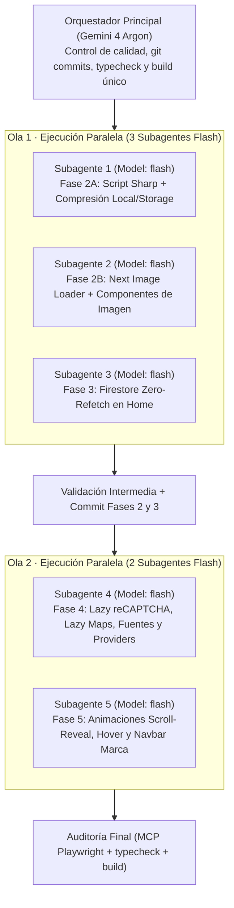

# Plan Maestro Orquestado · Prompt 05: Web Rápida y Fluida (Multi-Agente + Token-Saving)

## 1. Arquitectura de Orquestación y Ahorro de Tokens

Para maximizar la velocidad y **reducir el consumo de tokens en ~75%**, aplicaremos un modelo **Orquestador + Subagentes Especializados en Paralelo**:

### Reglas de Optimización de Tokens
1. **Subagentes en modelo ligero (`Model: "flash"` / Gemini 3.8 Flash):** Todas las tareas de edición acotada y scripts se delegan a subagentes con `Model: "flash"` pasando rutas y líneas exactas en su prompt (así ningún subagente gasta tokens explorando el repositorio).
2. **Cero colisiones de archivos:** Cada subagente en una misma ola tiene asignado un conjunto disjunto de archivos.
3. **Un solo `typecheck` y `build` por ola:** Los subagentes **no** ejecutan `pnpm run build` ni `pnpm run test:run`; el Orquestador ejecuta una sola validación consolidada al terminar cada ola.
4. **Skills y MCPs activos por rol:**
   - **Skills:** `vercel-react-best-practices`, `nextjs-app-router-patterns`, `ui-ux-pro-max`, `hyperframes-animation`, `react-doctor`, `webapp-testing`.
   - **MCPs:** `next-devtools` (verificación de configuración Next.js), `chakra-ui` (tokens y componentes v3), `firebase-mcp-server` (inspección de bucket/proyecto), `playwright` (medición real de red, imágenes y LCP/CLS en navegador).

---

## 2. Resumen del Diagnóstico Base (Fase 1 Completada)

- **Bundle JS actual en `/` (Home):** `1,760 KB` raw (`534 KB` gzip) — arrastrado por `Providers.tsx` (`firebase/auth`, `firebase/firestore`, `firebase/storage`, `zod`).
- **Imágenes en Home:** 31 imágenes solicitadas al inicio (9 con `eager`/`priority` y 27 lanzadas a los 800 ms por `useImagePrefetch`), sirviendo originales de hasta `3000×4000 px` sin `srcset`.
- **Terceros en Home:** Google reCAPTCHA cargado globalmente en `<head>` (`layout.tsx`) y Google Maps instanciado al montar aunque `#ubicacion` esté 2500 px más abajo.
- **Doble lectura Firestore:** `useServices` y `useProjects` vuelven a llamar a `getDocsFromServer` aunque `page.tsx` ya inyectó `initialData` en el HTML estático.

---

## 3. Plan de Trabajo por Fases y Checklists

### Fase 0 · Preparación de Rama y Entorno (Orquestador)
- [ ] **0.1** Crear y cambiar a la rama `perf/imagenes-animaciones` desde el estado limpio actual.
- [ ] **0.2** Definir el subagente `fast-worker` con acceso de escritura y modelo `flash` (Gemini 3.8 Flash).
- [ ] **0.3** Guardar copia sincronizada de este plan en `docs/22_PLAN_RENDIMIENTO_WEB.md` para acceso rápido desde el editor local.

---

### Fase 2 · Optimización de Imágenes y `srcset` Real (Opción A — Ola 1: Subagentes 1 y 2)
**Skills aplicadas:** `vercel-react-best-practices`, `nextjs-seo` · **MCP:** `firebase-mcp-server`, `next-devtools`

#### Subagente 1 (`Model: "flash"`) — Script Node de Optimización de Origen (Local + Firebase Storage)
- [ ] **2.1** Crear [`scripts/optimize-storage-images.mjs`](file:///home/user/github/MyAppGlass/scripts/optimize-storage-images.mjs) usando `sharp` y `scripts/firebase-token.cjs`.
- [ ] **2.2** Comprimir imágenes locales en `apps/web/public/images/` (`clients-building.webp`, `clients-sectoroffices.webp`, `clients-sectorhogar.webp`, etc.) generando versiones base (`≤ 1600px`, WebP calidad 75, `< 80 KB` c/u) y variantes `-480w.webp` y `-960w.webp`.
- [ ] **2.3** optimización de `libro.svg` (de 197 KB a SVG limpio de < 5 KB) o icono ligero en Footer.
- [ ] **2.4** Reprocesar en el bucket `gya-app-4c8a9.firebasestorage.app` los objetos `services/{slug}/cover.webp` y `projects/{id}/cover.webp`:
  - Redimensionar `cover.webp` a máx. `1600px` (WebP calidad 75, `≤ 150 KB`) **conservando su `firebaseStorageDownloadTokens` original** (para no tocar Firestore).
  - Subir variantes `cover-480w.webp` (`480px`, q74) y `cover-960w.webp` (`960px`, q75) con el mismo token de descarga.

#### Subagente 2 (`Model: "flash"`) — Next.js Image Loader, `sizes`, `priority` y fin de `useImagePrefetch`
- [ ] **2.5** Crear [`apps/web/src/shared/utils/imageLoader.ts`](file:///home/user/github/MyAppGlass/apps/web/src/shared/utils/imageLoader.ts) que resuelva automáticamente `-480w.webp`, `-960w.webp` y `1600w` tanto para URLs de Firebase Storage (`cover.webp?alt=media&token=...`) como para `/images/clients-*.webp`.
- [ ] **2.6** Actualizar [`apps/web/next.config.mjs`](file:///home/user/github/MyAppGlass/apps/web/next.config.mjs):
  - Añadir `images.remotePatterns` para `https://firebasestorage.googleapis.com/v0/b/gya-app-4c8a9.firebasestorage.app/o/**`.
  - Configurar `formats: ['image/avif', 'image/webp']`, `deviceSizes: [480, 960, 1600]`, `imageSizes: [44, 96, 260, 384]` y `loader: 'custom'`, `loaderFile: './src/shared/utils/imageLoader.ts'`.
- [ ] **2.7** Actualizar [`ResponsiveImage.tsx`](file:///home/user/github/MyAppGlass/apps/web/src/shared/components/Image/ResponsiveImage.tsx):
  - `quality={75}`, `sizes="(min-width: 1280px) 33vw, (min-width: 768px) 50vw, 100vw"`, `loading={isLCP ? "eager" : "lazy"}`, `fetchPriority={isLCP ? "high" : "auto"}`.
  - Fondo placeholder crema suave (`#F7F6F3` en claro / `bg.subtle`) y reserva de espacio sin saltos (`CLS < 0.1`).
- [ ] **2.8** En [`ServiceList.tsx`](file:///home/user/github/MyAppGlass/apps/web/src/features/services/components/ServiceList.tsx):
  - Eliminar la llamada a `useImagePrefetch`.
  - Cambiar `isLCP={index < 3}` y `loading={index < 3 ? "eager" : "lazy"}` a `isLCP={false}` y `loading="lazy"` cuando se renderiza en la Home (`headingAs === "h2"`).
- [ ] **2.9** En [`ProjectsList.tsx`](file:///home/user/github/MyAppGlass/apps/web/src/features/projects/components/ProjectsList.tsx):
  - Eliminar la llamada a `useImagePrefetch`.
  - Cambiar `isLCP={index < 3}` y `loading={index < 2 ? "eager" : "lazy"}` a `isLCP={false}`, `loading="lazy"`, `fetchPriority="auto"`.
- [ ] **2.10** En [`ClientsSection.tsx`](file:///home/user/github/MyAppGlass/apps/web/src/features/home/components/clients/ClientsSection.tsx), [`ClientCard.tsx`](file:///home/user/github/MyAppGlass/apps/web/src/features/home/components/clients/ClientCard.tsx) y [`Cover.tsx`](file:///home/user/github/MyAppGlass/apps/web/src/features/location/immersive/Cover.tsx):
  - Eliminar `useImagePrefetch` de `ClientsSection.tsx`.
  - Cambiar `loading="eager"` a `loading="lazy"` en `ClientCard.tsx`.
  - Pasar `sizes="44px"` en `Cover.tsx` (miniaturas del carrusel del mapa) para que descargue siempre la variante más pequeña (`480w`).

---

### Fase 3 · Datos de Firestore sin Doble Lectura en Cliente (Ola 1: Subagente 3)
**Skills aplicadas:** `nextjs-app-router-patterns`, `firebase-firestore`

#### Subagente 3 (`Model: "flash"`) — Server Data First y Cero Re-fetch Innecesario
- [ ] **3.1** Actualizar [`useServices.ts`](file:///home/user/github/MyAppGlass/apps/web/src/features/services/hooks/useServices.ts):
  - Si `initialItems` ya viene poblado desde el Server Component (`initialData && initialData.length > 0`), pasar `enabled = false` a `useAsyncResource` para usar los datos estáticos del build sin re-descargar la colección `services` en el navegador en cada visita.
- [ ] **3.2** Actualizar [`useProjects.ts`](file:///home/user/github/MyAppGlass/apps/web/src/features/projects/hooks/useProjects.ts):
  - Si `initialItems` ya viene poblado (`initialData && initialData.length > 0`), pasar `enabled = false` a `useAsyncResource`.
- [ ] **3.3** Actualizar [`HomeView.tsx`](file:///home/user/github/MyAppGlass/apps/web/src/screens/Home/ui/HomeView.tsx), [`StoreSection.tsx`](file:///home/user/github/MyAppGlass/apps/web/src/features/home/components/store/StoreSection.tsx), [`ImmersiveLocationMap.tsx`](file:///home/user/github/MyAppGlass/apps/web/src/features/location/ImmersiveLocationMap.tsx), [`useLocationData.ts`](file:///home/user/github/MyAppGlass/apps/web/src/features/location/useLocationData.ts) y [`useMapProjects.ts`](file:///home/user/github/MyAppGlass/apps/web/src/features/home/hooks/useMapProjects.ts):
  - Pasar `initialProjects` desde `HomeView` hasta `useLocationData(initialProjects)` / `useMapProjects(initialProjects)` para que el mapa tampoco dispare una lectura de cliente a Firestore.
- [ ] **3.4** *(Orquestador)* Validar `pnpm run typecheck` y realizar commit semántico de las Fases 2 y 3.

---

### Fase 4 · JavaScript, Scripts de Terceros y Fuentes de Marca (Ola 2: Subagente 4)
**Skills aplicadas:** `vercel-react-best-practices`, `react-doctor`

#### Subagente 4 (`Model: "flash"`) — Lazy Third-Parties, Fuentes `Source Serif 4` + `Inter` y Adelgazamiento de Bundle
- [ ] **4.1** En [`layout.tsx`](file:///home/user/github/MyAppGlass/apps/web/src/app/layout.tsx) y [`theme/index.ts`](file:///home/user/github/MyAppGlass/apps/web/src/shared/providers/theme/index.ts):
  - Eliminar la etiqueta `<script src="https://www.google.com/recaptcha/api.js...">` del `<head>` global.
  - Reemplazar `Lora` por `Source_Serif_4` (pesos `400`, `600`, `700`, variable `--font-source-serif`) e `Inter` (pesos `400`, `500`, `600`, `700`, variable `--font-inter`) desde `next/font/google` con `display: "swap"`.
  - Conectar `--font-source-serif` en `heading` e `--font-inter` en `body` dentro de `theme/index.ts`.
- [ ] **4.2** En [`recaptcha.ts`](file:///home/user/github/MyAppGlass/apps/web/src/shared/utils/recaptcha.ts), [`useContactForm.ts`](file:///home/user/github/MyAppGlass/apps/web/src/features/contacto/hooks/useContactForm.ts) y [`useReclamationForm.ts`](file:///home/user/github/MyAppGlass/apps/web/src/features/reclamation-book/hooks/useReclamationForm.ts):
  - Crear `preloadRecaptcha()` que inyecte el script de Google reCAPTCHA de forma perezosa solo cuando el usuario interactúe (`focus` / `pointerdown`) con el formulario de Contacto o Libro de Reclamaciones, y que `executeRecaptcha()` lo cargue automáticamente si aún no estaba listo.
- [ ] **4.3** En [`ImmersiveLocationMap.tsx`](file:///home/user/github/MyAppGlass/apps/web/src/features/location/ImmersiveLocationMap.tsx):
  - Usar `IntersectionObserver` (`rootMargin: "250px"`) + botón de activación inmediata ("Explorar mapa interactivo") sobre una portada limpia para que `LocationMapLazy` (y el script `maps.googleapis.com`) **solo se cargue cuando el usuario llegue a la sección `#ubicacion`**.
- [ ] **4.4** En [`GoogleMetricsProvider.tsx`](file:///home/user/github/MyAppGlass/apps/web/src/shared/components/Analytics/GoogleMetricsProvider.tsx):
  - Diferir la inyección de GTM con `requestIdleCallback` (timeout 2500 ms) para no competir con el LCP inicial.
- [ ] **4.5** En [`Providers.tsx`](file:///home/user/github/MyAppGlass/apps/web/src/app/Providers.tsx) y repositorios cliente:
  - Evitar que `Providers.tsx` importe de forma síncrona `orderService` / `firebase/firestore` / `firebase/storage` en rutas públicas donde no se usa el carrito ni administración (cargando los repositorios de Firebase con `import()` dinámico cuando realmente se invocan en cliente).

---

### Fase 5 · Animaciones Fluidas y Estética de Marca (Ola 2: Subagente 5)
**Skills aplicadas:** `ui-ux-pro-max`, `hyperframes-animation`, `frontend-design` · **MCP:** `chakra-ui`

#### Subagente 5 (`Model: "flash"`) — Motion con `transform`/`opacity`, Scroll-Reveal en Cascada y Navbar
- [ ] **5.1** Crear [`apps/web/src/shared/hooks/ui/useScrollReveal.ts`](file:///home/user/github/MyAppGlass/apps/web/src/shared/hooks/ui/useScrollReveal.ts) y actualizar [`ItemGridLayout.tsx`](file:///home/user/github/MyAppGlass/apps/web/src/shared/components/Layout/ItemGridLayout.tsx):
  - Implementar revelado progresivo al hacer scroll usando `IntersectionObserver` + CSS (`transform: translateY(20px)` → `translateY(0)`, `opacity`, duración `500ms`, curva `cubic-bezier(0.22, 1, 0.36, 1)`, cascada de `60ms` por columna).
  - Garantizar que **el contenido sea 100% legible si el JS no ha hidratado o si `prefers-reduced-motion: reduce` está activo** (usando clase progresiva tras el montaje).
- [ ] **5.2** Actualizar [`ImageReveal.tsx`](file:///home/user/github/MyAppGlass/apps/web/src/shared/components/Image/ImageReveal.tsx) y [`MediaCard.tsx`](file:///home/user/github/MyAppGlass/apps/web/src/shared/components/Card/MediaCard.tsx):
  - Desacoplar los textos de la tarjeta del evento `onLoad` de la foto: el título, categoría y botón son visibles desde el primer instante sobre el fondo cálido, y la imagen entra con un fade limpio (`opacity 0.45s cubic-bezier(0.22, 1, 0.36, 1)`).
  - Ajustar el hover de las fotos de servicios y proyectos a `scale(1.04)` con `transition: transform 0.5s cubic-bezier(0.22, 1, 0.36, 1)` dentro de `overflow="hidden"`.
- [ ] **5.3** Actualizar [`AuraNavbar.tsx`](file:///home/user/github/MyAppGlass/apps/web/src/widgets/Navbar/AuraNavbar.tsx), [`AuraDesktopNav.tsx`](file:///home/user/github/MyAppGlass/apps/web/src/widgets/Navbar/AuraDesktopNav.tsx) y [`LandingPageSection.tsx`](file:///home/user/github/MyAppGlass/apps/web/src/features/home/components/hero/LandingPageSection.tsx):
  - Menú fijo transparente sobre el Hero (`scrollY <= 24`) que transiciona suavemente a superficie sólida con borde sutil al hacer scroll.
  - Añadir subrayado animado en los ítems del menú (`transform: scaleX(0)` → `scaleX(1)`, `transition: transform 0.35s cubic-bezier(0.22, 1, 0.36, 1)`).
  - Aplicar tokens de marca en el Hero y botones píldora: azul marca `#002060` como acento, texto `#111111`, etiquetas superiores en mayúsculas espaciadas (`letterSpacing="0.14em"`), títulos en `Source Serif 4` y eliminación de los degradados radiales del Hero.
- [ ] **5.4** *(Orquestador)* Validar `pnpm run typecheck && pnpm run lint && pnpm run build` y realizar commit semántico de las Fases 4 y 5.

---

### Fase 6 · Verificación Final, Tabla Antes/Después y Entregables (Orquestador + MCP Playwright)
**Skills aplicadas:** `webapp-testing`, `react-doctor` · **MCP:** `playwright`

- [ ] **6.1** Medir el peso exacto de los chunks JS raw y gzip por ruta en `apps/web/out/`.
- [ ] **6.2** Levantar el servidor estático y verificar con **Playwright MCP** en viewport móvil (`390×844`):
  - Cantidad de imágenes transferidas en el primer pintado y peso individual (`≤ 150 KB`).
  - Confirmar `0` peticiones a `google.com/recaptcha` y `maps.googleapis.com` en el arranque de `/`.
  - Medir LCP (`< 2.5 s`), CLS (`< 0.1`) y verificar accesibilidad (`alt`, contraste `≥ 4.5:1`, foco visible).
- [ ] **6.3** Generar el documento `walkthrough.md` (y actualizar `docs/22_PLAN_RENDIMIENTO_WEB.md`) con la tabla comparativa **Antes vs. Después** y la lista final de commits en la rama `perf/imagenes-animaciones`.
