# README | Manual de Arquitectura e Ingeniería de Software

**Portal Corporativo GYA — Glass & Aluminum Company S.A.C.**
Documento técnico de referencia · Versión 2.0 · 2026

---

> **Resumen ejecutivo:**
> Este compendio constituye la especificación canónica y manual de ingeniería para el ecosistema **MyAppGlass** de *Glass & Aluminum Company S.A.C.* El sistema implementa una arquitectura desacoplada basada en **Next.js 16 (App Router; el build usa `next build --webpack`)** bajo la metodología **Feature-Sliced Design (FSD)**, renderizado estático de alto rendimiento (SSG/Export), aceleración por GPU para tasas de refresco de 120 Hz, contratos de datos formales con **Zod + TypeScript**, y microservicios serverless en **Google Cloud Functions v2 + Firestore**.

---

## § 1. Tabla de Contenidos Estructurada

```
├── § 1. Tabla de Contenidos Estructurada
├── § 2. Taxonomía y Grafo de Navegación del Sistema
├── § 3. Módulos y Especificaciones Formales
│   ├── 3.1. Arquitectura y Gobierno del Código (Core Architecture)
│   │   ├── 01_ARCHITECTURE.md
│   │   ├── 02_AI_HANDOFF.md
│   │   ├── 03_AGENTS.md
│   │   ├── 04_PLAN_DE_TRABAJO.md
│   │   └── 05_CHANGELOG.md
│   ├── 3.2. Ingeniería de Frontend y Sistema de Diseño Aura (UI/UX Engine)
│   │   └── 06_DOCS_DEVELOPMENT.md
│   ├── 3.3. Infraestructura Backend, Seguridad y Normativa Legal (Backend & Compliance)
│   │   ├── 07_BACKEND_IMPLEMENTATION.md
│   │   └── 08_DOCS_SECURITY_BACKEND.md
│   ├── 3.4. Estrategia de SEO Técnico, Grafos de Conocimiento y Marketing (SEO & Discovery)
│   │   ├── 09_PLAN_SEO_CONTENIDOS.md
│   │   ├── 10_SEO_JERARQUIA.md
│   │   └── 11_MANUAL_SEO_LOCAL.md
│   ├── 3.5. Plataforma Transaccional: E-Commerce, Inventario, Presupuestos y AR (Next Generation)
│   │   └── 12_PLAN_ECOMMERCE_INVENTARIO_AR.md
│   └── 3.6. Gestión Ágil por Sprints: Framework Scrum y Roles Seniors (Agile Operations)
│       └── 13_PLAN_TRABAJO_SCRUM_FASES.md
├── § 4. Matriz de Decisiones de Ingeniería y Algoritmos (Complexity Matrix)
├── § 5. Guía de Operaciones y Casos de Uso Frecuentes (Standard Operating Procedures)
└── § 6. Protocolo de Calidad, Verificación Formal y CI/CD
```

---

## § 2. Taxonomía y Grafo de Navegación del Sistema

```mermaid
graph TD
    classDef root fill:#0f172a,stroke:#38bdf8,stroke-width:2px,color:#fff;
    classDef domain fill:#1e293b,stroke:#818cf8,stroke-width:1.5px,color:#e2e8f0;
    classDef leaf fill:#020617,stroke:#64748b,stroke-width:1px,color:#94a3b8;

    Root["📚 Manual Canónico (docs/README.md)"]:::root

    D1["§ 3.1. 🏛️ Arquitectura & Gobierno"]:::domain
    D2["§ 3.2. 💻 Frontend & Diseño Aura"]:::domain
    D3["§ 3.3. 🛡️ Backend & Seguridad"]:::domain
    D4["§ 3.4. 📈 SEO & Descubrimiento"]:::domain
    D5["§ 3.5. 🛒 E-Commerce & AR"]:::domain
    D6["§ 3.6. 🏃‍♂️ Scrum & Sprints"]:::domain

    Root --> D1
    Root --> D2
    Root --> D3
    Root --> D4
    Root --> D5
    Root --> D6

    D1 --> F01["01_ARCHITECTURE.md (FSD & Boxflow)"]:::leaf
    D1 --> F02["02_AI_HANDOFF.md (Contratos & Clean Code)"]:::leaf
    D1 --> F03["03_AGENTS.md (10 Roles Especializados)"]:::leaf
    D1 --> F04["04_PLAN_DE_TRABAJO.md (Roadmap 5 Fases)"]:::leaf
    D1 --> F05["05_CHANGELOG.md (Historial de Versiones)"]:::leaf

    D2 --> F06["06_DOCS_DEVELOPMENT.md (Tokens Fibonacci & 120Hz)"]:::leaf

    D3 --> F07["07_BACKEND_IMPLEMENTATION.md (Serverless & Resend)"]:::leaf
    D3 --> F08["08_DOCS_SECURITY_BACKEND.md (Secret Manager & Indecopi)"]:::leaf

    D4 --> F09["09_PLAN_SEO_CONTENIDOS.md (Topic Clusters & Blog)"]:::leaf
    D4 --> F10["10_SEO_JERARQUIA.md (Taxonomía H1-H3 & Metas)"]:::leaf
    D4 --> F11["11_MANUAL_SEO_LOCAL.md (Google Maps & Search Console)"]:::leaf

    D5 --> F12["12_PLAN_ECOMMERCE_INVENTARIO_AR.md (RBAC, Zod, PDF & WebXR)"]:::leaf

    D6 --> F13["13_PLAN_TRABAJO_SCRUM_FASES.md (Checklist por Roles & DoD)"]:::leaf
```



---

## § 3. Módulos y Especificaciones Formales

### 3.1. Arquitectura y Gobierno del Código (Core Architecture)

**Dominio:** capas FSD, contratos de tipos, roles de agentes, roadmap y versionado.

* **[3.1.1. `01_ARCHITECTURE.md`](./01_ARCHITECTURE.md):**
  Define la descomposición en capas FSD: `app` → `screens` → `widgets` → `features` → `shared`. Detalla el patrón de componentes compuestos (`Gallery.Root`, `Viewer`, `Thumbnails`) y el flujo desacoplado de datos.
* **[3.1.2. `02_AI_HANDOFF.md`](./02_AI_HANDOFF.md):**
  Especificación de interoperabilidad y lineamientos estrictos para agentes y desarrolladores: normalización de nomenclatura comercial (*Glass & Aluminum Company S.A.C.*), ortografía técnica (*antirruido* con doble *r*), y aislamiento del backend.
* **[3.1.3. `03_AGENTS.md`](./03_AGENTS.md):**
  Matriz de responsabilidad de los 10 agentes seniors de ingeniería (Frontend Architect, Security Officer, QA Engineer, A11y Advocate, SEO Strategist, etc.).
* **[3.1.4. `04_PLAN_DE_TRABAJO.md`](./04_PLAN_DE_TRABAJO.md):**
  Auditoría y estado de completitud de las 5 fases estratégicas del proyecto.
* **[3.1.5. `05_CHANGELOG.md`](./05_CHANGELOG.md):**
  Registro histórico de despliegues, optimizaciones y refactorizaciones.

---

### 3.2. Ingeniería de Frontend y Sistema de Diseño Aura (UI/UX Engine)

* **[3.2.1. `06_DOCS_DEVELOPMENT.md`](./06_DOCS_DEVELOPMENT.md):**
  Manual de desarrollo local. Implementa el sistema de espaciado y tipografía basado en **Chakra UI v3 nativo** (escala de espaciado con base de 4 px: `space.1`=4px, `space.4`=16px, `space.8`=32px, `space.12`=48px, `space.16`=64px).
  Establece los requisitos de aislamiento de repintado (`contain: layout style`) y aceleración por hardware (`translateZ(0)`) para mantener una tasa de refresco constante de 120 Hz y un CLS de 0.

---

### 3.3. Infraestructura Backend, Seguridad y Normativa Legal (Backend & Compliance)

**Dominio:** Cloud Functions v2, Firestore (NoSQL), Resend SDK, Secret Manager.

* **[3.3.1. `07_BACKEND_IMPLEMENTATION.md`](./07_BACKEND_IMPLEMENTATION.md):**
  Especificación de endpoints serverless (`submitContacto`, `submitReclamo`, `checkStatus`), transacciones atómicas y entrega de notificaciones vía Resend.
* **[3.3.2. `08_DOCS_SECURITY_BACKEND.md`](./08_DOCS_SECURITY_BACKEND.md):**
  Protocolo de seguridad en la nube (Cloud Run + Secret Manager). Cumplimiento legal de retención de registros de INDECOPI (mínimo 2 años; respuesta en un máximo de 15 días hábiles) y Ley N° 29733 de Protección de Datos Personales.

---

### 3.4. Estrategia de SEO Técnico, Grafos de Conocimiento y Marketing (SEO & Discovery)

**Dominio:** Schema.org JSON-LD, Topic Clusters, Local 3-Pack, arquitectura Silo.

* **[3.4.1. `09_PLAN_SEO_CONTENIDOS.md`](./09_PLAN_SEO_CONTENIDOS.md):**
  Arquitectura Silo y Topic Clusters de autoridad técnica (Ventanas Antirruido, Mamparas de Vidrio Templado vs Laminado, Techos de Policarbonato).
* **[3.4.2. `10_SEO_JERARQUIA.md`](./10_SEO_JERARQUIA.md):**
  Diccionario formal de etiquetas semánticas: `<title>`, `<meta name="description">`, encabezados H1 → H2 → H3 por ruta estática.
* **[3.4.3. `11_MANUAL_SEO_LOCAL.md`](./11_MANUAL_SEO_LOCAL.md):**
  Manual de operaciones para dominancia local en La Molina, Lima (Google Business Profile, Google Search Console, Canonical 301, Citas NAP).

---

### 3.5. Plataforma Transaccional: E-Commerce, Inventario, Presupuestos y AR (Next Generation)

**Dominio:** autenticación con roles (RBAC), motor de stock, generador de cotizaciones PDF, Apple QuickLook / Google SceneViewer.

* **[3.5.1. `12_PLAN_ECOMMERCE_INVENTARIO_AR.md`](./12_PLAN_ECOMMERCE_INVENTARIO_AR.md):**
  Especificación maestra multidisciplinaria (MBA, Arquitecto de Software, Oficial de Seguridad, UI/UX y Especialista 3D):
  - Modelo de Usuarios y Roles (`admin` y `cliente` con DNI/RUC, teléfono, dirección).
  - CRUD de Productos e Inventario en tiempo real (vidrios, perfiles de aluminio y accesorios).
  - Cotizador formal de instalaciones con desglose métrico de materiales, mano de obra y exportación PDF A4 con QR.
  - Módulo de Realidad Aumentada nativa (`.usdz` en iOS / `.glb` en Android y 3D en Desktop).
  - Reglas zero-trust en `firestore.rules` y `storage.rules` para `products/`.

  > Nota: el documento es una especificación; el estado real de implementación (inventario, pedidos de admin y cotizador implementados; tienda pública y AR pendientes) está en su sección «Estado de implementación».

---

### 3.6. Gestión Ágil por Sprints: Framework Scrum y Roles Seniors (Agile Operations)

**Dominio:** objetivos de sprint, checklist por rol senior, Definition of Done (DoD).

* **[3.6.1. `13_PLAN_TRABAJO_SCRUM_FASES.md`](./13_PLAN_TRABAJO_SCRUM_FASES.md):**
  Desglose operativo de los 5 Sprints del proyecto con checklist por especialista (Scrum Master, MBA, Arquitecto, Frontend, Backend, UI/UX, 3D Specialist, QA) y criterios de aceptación formales.

---

## § 4. Matriz de Decisiones de Ingeniería y Algoritmos (Complexity Matrix)

| Componente / Servicio | Estructura de datos | Búsqueda | Espacio | Justificación técnica |
|---|---|:-:|:-:|---|
| `projectService.ts` | HashMap (`Map<ID, Project>`) | O(1) | O(n) | Indexación instantánea sin iteración lineal. |
| `serviceService.ts` | HashMap (`Map<Slug, Service>`) | O(1) | O(n) | Resolución estática en SSG (`generateStaticParams`). |
| `blogService.ts` | HashMap (`Map<Slug, Post>`) | O(1) | O(n) | Cero latencia en renderizado de artículos. |
| `reclamation-schema.ts` | Zod AST parsing | O(k) | O(k) | Validación exhaustiva y tipado estricto en runtime. |
| `productService.ts` | Firestore (batch + índice) | O(log n) | O(m) | Consistencia transaccional de stock. |

---

## § 5. Guía de Operaciones y Casos de Uso Frecuentes (Standard Operating Procedures)

| Objetivo operativo | Documento de referencia | Ruta / procedimiento |
|---|---|---|
| Inicializar entorno local y dependencias | `06_DOCS_DEVELOPMENT.md` | `pnpm install && pnpm run dev` |
| Plan de Sprints Scrum y checklists | `13_PLAN_TRABAJO_SCRUM_FASES.md` | Checklist de actividades por rol senior |
| Arquitectura E-Commerce e inventario | `12_PLAN_ECOMMERCE_INVENTARIO_AR.md` | Especificación completa y reglas RBAC |
| Agregar o editar artículo del blog | `09_PLAN_SEO_CONTENIDOS.md` | `src/features/blog/data/blog-posts.ts` |
| Modificar reglas de diseño y espaciado | `06_DOCS_DEVELOPMENT.md` | Chakra UI spacing en `src/shared/providers/theme/` |
| Auditar flujo legal del Libro de Reclamaciones | `07_BACKEND_IMPLEMENTATION.md` | Colección Firestore `libro_de_reclamaciones` |
| Configuración de SEO local (Google Maps) | `11_MANUAL_SEO_LOCAL.md` | Google Business Profile (La Molina, Lima) |

---

## § 6. Protocolo de Calidad, Verificación Formal y CI/CD

El pipeline de CI (`.github/workflows/ci.yml`, en push/PR a `main` y `develop`) ejecuta en orden: ESLint → Typecheck (TSC) → pruebas unitarias (Vitest) → build de producción (`next build --webpack`, exportación estática a `out/`).

Comandos equivalentes en local:

```bash
# 1. Pruebas unitarias de regresión (18 archivos en tests/unit/, ~129 casos)
#    Nota: los agentes de IA no la ejecutan salvo petición expresa (ver AGENTS.md)
pnpm run test:run

# 2. Verificación estricta de tipos
pnpm run typecheck

# 3. Análisis estático de código
pnpm run lint

# 4. Compilación y generación estática (60 páginas)
pnpm run build
```

---

Glass & Aluminum Company S.A.C. — Todos los derechos reservados.
