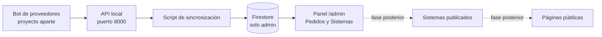
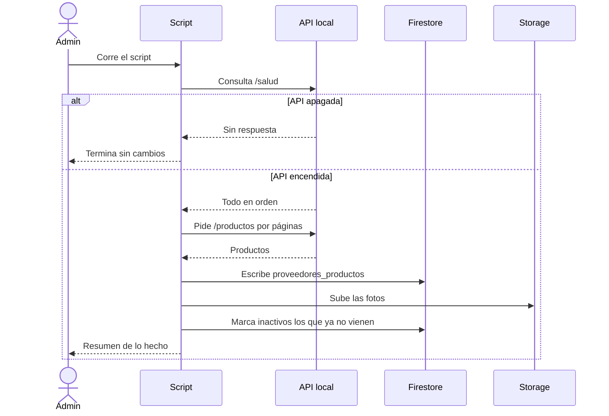
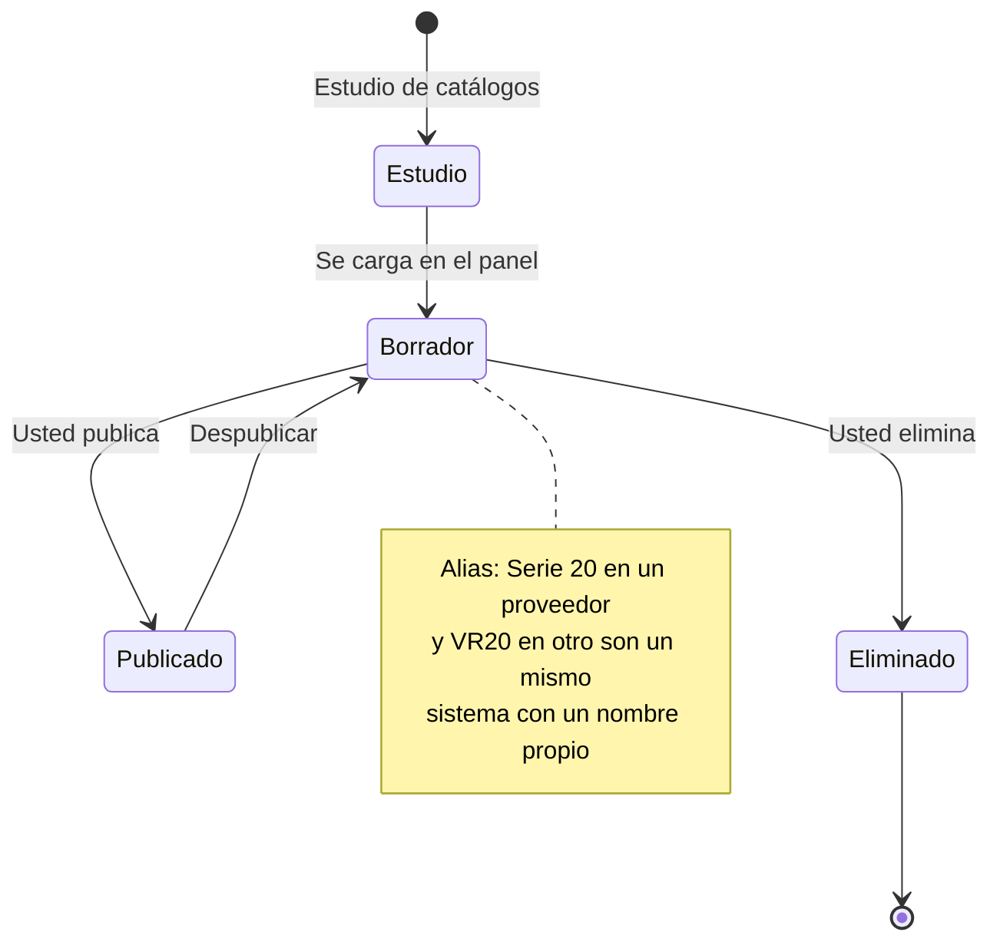
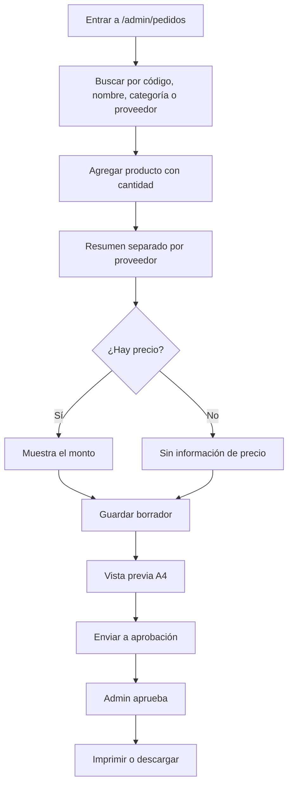
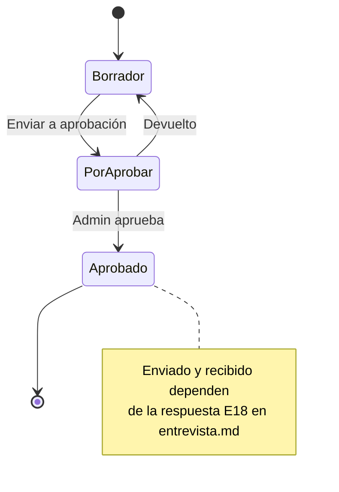
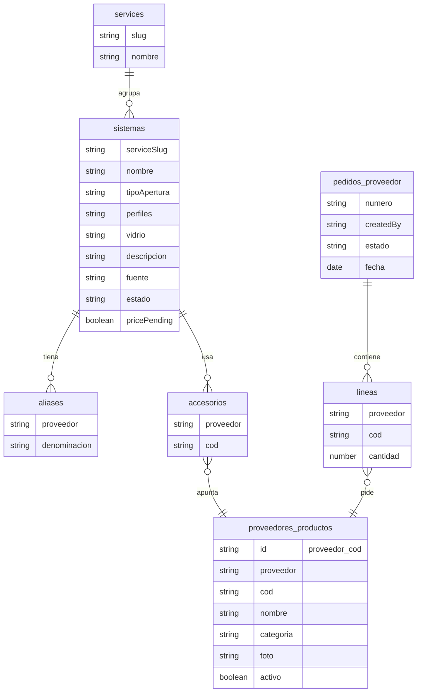
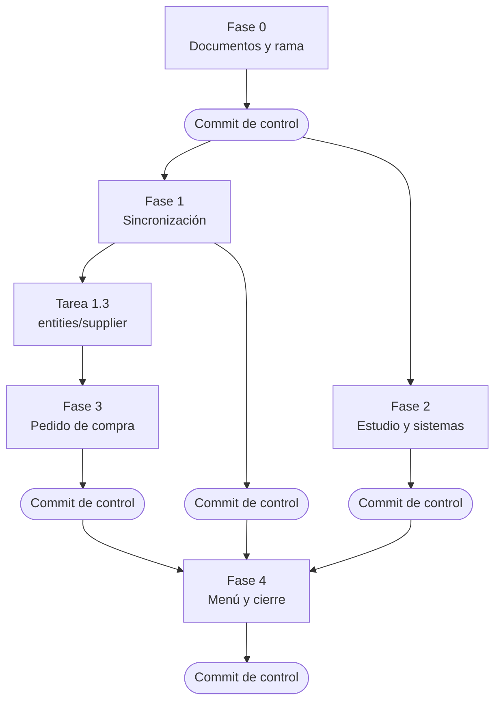

# Flujos del dashboard de proveedores

Documento para revisión del dueño. Muestra cómo va a funcionar el sistema, sin entrar en código. Los diagramas se dibujan solos en GitHub.

Regla de fondo: el cliente nunca ve a los proveedores. Sus datos viven solo en el panel de administración.

## 1. Vista general

- El bot de proveedores es un proyecto aparte que junta los catálogos y los deja disponibles en una API que corre en su computadora.
- El script copia esos datos a Firestore, y desde ahí los lee el panel. Así el panel funciona aunque la API esté apagada.
- Solo el administrador puede leer esos datos. El cliente nunca ve proveedores, fotos ni planos de ellos.
- La línea punteada es una fase posterior: los sistemas que usted publique llegarían a las páginas públicas, sin datos de proveedores.

## 2. Sincronización

- Antes de tocar nada, el script pregunta si la API está encendida. Si no lo está, termina y no cambia nada.
- Si está encendida, trae los productos por tandas y los guarda en Firestore.
- Las fotos se suben a Storage, también con acceso solo para el administrador.
- Lo que el proveedor ya no trae se marca como inactivo, no se borra. Al final recibe un resumen.

## 3. Vida de un sistema

- Primero se estudian los catálogos de los proveedores y se identifican los sistemas.
- Todo sistema nuevo entra como borrador: nadie fuera del panel lo ve.
- Usted decide si lo publica o lo elimina. Un sistema publicado puede volver a borrador.
- Cada proveedor llama distinto a lo mismo, por eso el sistema guarda sus alias y tiene un nombre propio de la empresa.

## 4. Pedido de compra

- Se busca el producto, se agrega con su cantidad y el pedido se ordena solo por proveedor.
- Hoy ningún producto trae precio, así que verá "Sin información de precio" hasta que usted lo defina.
- El borrador se puede guardar y retomar. La vista previa muestra la hoja A4 tal como saldrá.
- Un pedido solo se imprime o descarga cuando el administrador lo aprueba.

## 5. Estados del pedido

- Un pedido nace como borrador y puede corregirse cuantas veces haga falta.
- Al enviarlo pasa a "por aprobar". Quien aprueba lo deja aprobado o lo devuelve a borrador.
- Cada pedido guarda quién lo creó y en qué estado está.
- Los estados "enviado" y "recibido" quedan pendientes de su respuesta E18 en `entrevista.md`.

## 6. Modelo de datos

- `proveedores_productos` es la copia del catálogo de proveedores, un documento por producto.
- `sistemas` pertenece a un servicio, guarda sus alias por proveedor y los accesorios, que apuntan a productos del catálogo.
- `pedidos_proveedor` guarda quién lo creó, su estado y sus líneas; cada línea apunta a un producto.
- Los campos del pedido y del producto pueden ajustarse al construir; el plan fija los de sistemas y pedido.

## 7. Cómo se reparte el trabajo

- La Fase 0 prepara los documentos y la rama.
- Las fases 1 y 2 corren al mismo tiempo, porque el estudio solo lee documentos.
- La Fase 3 arranca apenas termina la tarea 1.3, sin esperar el resto de la Fase 1.
- La Fase 4 enlaza todo en el menú y cierra.
- Cada fase termina con un commit de control, y solo si build, typecheck y lint están en verde.
